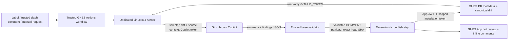

# Architecture, trust boundaries, and limitations

This is a custom Actions integration. GHES provides events/source/review APIs;
GitHub.com provides Copilot inference; a GHES GitHub App provides the public
review identity. None of these makes the App a native selectable Copilot
reviewer or installs the cloud coding agent.

## Data flow

1. Only explicit review requests pass the job gate. Slash comments must be
   exactly `/copilot review`, on a PR, from an `OWNER`, `MEMBER`, or
   `COLLABORATOR`. Labeling requires existing GHES label privileges; manual
   dispatch requires existing workflow privileges.
2. Job-level concurrency cancels the previous accepted job for that repository
   and PR. Skipped jobs for unrelated/untrusted comments do not replace a
   legitimate request.
3. With the read-only GHES workflow token, fetch PR metadata from
   `${GITHUB_API_URL}/repos/${GITHUB_REPOSITORY}/pulls/${PR_NUMBER}`.
   On GHES, `GITHUB_API_URL` includes `/api/v3`.
4. Clone the trusted base branch without checkout hooks/credential helpers,
   check out the exact base SHA, and copy its regular, non-symlink validator
   outside the repository. Only then fetch `refs/pull/{number}/head`, check
   it matches the metadata, and detach at the exact head SHA.
5. Refuse a PR-controlled `.copilot-review-context` path. Download the canonical
   API unified diff into the fresh context directory and verify metadata again
   so a changing PR is not mixed with a different snapshot.
6. Copilot CLI reads the diff/changed-files list and necessary surrounding source
   with only `view`, `grep`, and `glob`. Save its response as local JSON.
7. The preserved trusted validator checks the model schema and maps RIGHT-side
   line numbers to canonical diff `position` values. It never executes model
   text or imports code from the PR.
8. Only the publish step receives the GHES App key. It signs an RS256 JWT,
   resolves the repository installation, requests a short-lived token scoped
   to this repository/PR permission, rechecks the snapshot, and posts
   `/pulls/{number}/reviews`. The response must be `COMMENTED`, Bot-authored,
   and anchored to the reviewed commit.
9. After a successful label-triggered review, remove `copilot-review` using the
   installation token. Cleanup failures produce warnings, not a duplicate review
   retry. The always-run cleanup removes the exact per-run workspace.

## Three credential boundaries

| Credential | Injection point | Authority |
| --- | --- | --- |
| GHES `GITHUB_TOKEN` as `GHES_TOKEN` | Clone/metadata/diff step only | `contents: read`, `pull-requests: read` |
| GitHub.com `COPILOT_GITHUB_TOKEN` | Inference/validation step only | Copilot Requests for the approved token owner's entitlement; not GHES write authority |
| GHES App ID/private key | Publish step only | App JWT, then repository-scoped installation token with `pull_requests: write`; metadata implicit |

Git uses an ephemeral askpass helper rather than an embedded token URL or stored
credential. The helper is removed before inference. The App private key/token
response files have restrictive permissions and are removed promptly; the
derived JWT/token are masked in Actions output. The workflow does not upload
the model response, key, diff, or CLI home as artifacts.

The App token can read PR metadata immediately before publication because its
write permission includes reads. Repository source checkout and canonical diff
retrieval still use the separate read-only workflow token. No App Contents
permission is requested.

## Validator contract

The response must be one object with exactly `summary` and `findings`.
Each finding must have exactly `severity`, `path`, `line`, `title`, and `body`.
Severity is critical/high/medium/low, the path must be relative and safe, and
the line must be a positive integer (not a Boolean).

The validator accepts at most the first eight findings, de-duplicates locations,
sanitizes text/mentions, and discards unsupported locations or malformed
findings with an explicit count. Its limits are:

| Input | Limit |
| --- | --- |
| Canonical API diff | 1,000,000 bytes |
| Model output | 100,000 bytes |
| Summary / title / body before mention neutralization | 4,000 / 160 / 2,500 characters |
| Published findings | 8 |

The byte limits are enforced in the workflow and trusted Python entry point.
Literal tabs/newlines/control characters inside model JSON strings are
intentionally accepted by `json.loads(strict=False)` and then normalized.
Markdown fences, extra fields, duplicate JSON keys, non-finite constants, and
invalid top-level types are rejected. There is no permissive text-to-JSON
extraction, model-provided command execution, or success fallback for invalid JSON.

Inline comments have exactly `{path, position, body}` and belong to one
`COMMENT` review with `commit_id` equal to the exact reviewed head SHA.
Added **and visible context** lines on the RIGHT side are eligible.
Deleted lines, invisible/off-diff lines, and binary-only locations are discarded.
The canonical GHES API diff, not a locally reconstructed diff, determines
positions across hunks/files, deletions, and no-newline markers.

## What the controls do not guarantee

**This is not an OS sandbox or complete secret-isolation boundary.** A clean
`COPILOT_HOME`, tool allowlist, disabled custom instructions/built-in MCPs/
remote export/auto-update, and an instruction to ignore repository prompts
are defense in depth. The CLI process still runs as the runner account, has
network access for inference, and receives its own inference credential.
Repository symlinks and malicious source content remain security inputs.
Do not rely on a prompt or CLI home to make a shared host safe.

The workflow does not intentionally execute PR builds, tests, scripts,
submodules, hooks, or package installs. Its clone ignores global/system Git
configuration, uses an empty hook template and disables hooks, so PR checkout
does not inherit custom smudge drivers or developer credential helpers.
Do not add `npm test`, a project build, arbitrary shell tools, `--allow-all`,
or additional actions after checking out untrusted PR code.

A compromised runner, tampered CLI/toolchain, malicious trusted workflow/base
validator, or another job running as the same OS account can defeat these
controls. Protect the runner, tools, repository write access, workflow changes,
App keys, and network egress accordingly. Fork requests need an explicit
customer risk decision; being technically able to fetch a fork PR is not
approval to expose a privileged self-hosted runner to it.

Normal success/failure/cancellation uses `if: always()` cleanup, but a host crash,
forced process termination, or runner loss may prevent it. Treat runner storage,
Actions logs/step summaries, reviewed code, CLI home/history, and model responses
as sensitive. Apply customer retention, access controls, reimaging, and a safe
orphan-workspace cleanup procedure. Do not collect raw secrets/transcripts
in support tickets.

## Cloud processing and review semantics

This is **not air-gapped** and does not provide on-premises model inference.
The diff, paths, and any source selected through read tools are sent to the
approved Copilot service. Disable remote session export does not disable
inference processing or all service telemetry. Determine applicable Copilot
plan/model policies, data processing/retention terms, residency requirements,
and customer consent before use. The kit makes no zero-retention or training
policy promise and must not be used to bypass organizational exclusions.

Inference consumes the approved token owner's Copilot entitlement/usage.
Rate limits, request costs, model availability, and outputs can change.
No inference is invoked by distribution CI or offline tests; customer acceptance
must exercise the actual service with approval.

A model review is advisory, not proof of correctness or a security audit.
No findings is not an approval. Invalid/discarded findings are reported as such,
not proof that the change is safe. The App posts `COMMENT`, never `APPROVE` or
`REQUEST_CHANGES`, and does not set a required merge check.

Metadata checks reject changes detected during checkout/diff/inference. GHES
does not provide an atomic "only if current head" review operation, so a push
immediately after the last check can make a correctly anchored review outdated.
The explicit `commit_id` still identifies the reviewed snapshot. Publication is
not automatically retried: an ambiguous network failure after POST may already
have created a review. Inspect the PR before requesting another run.
